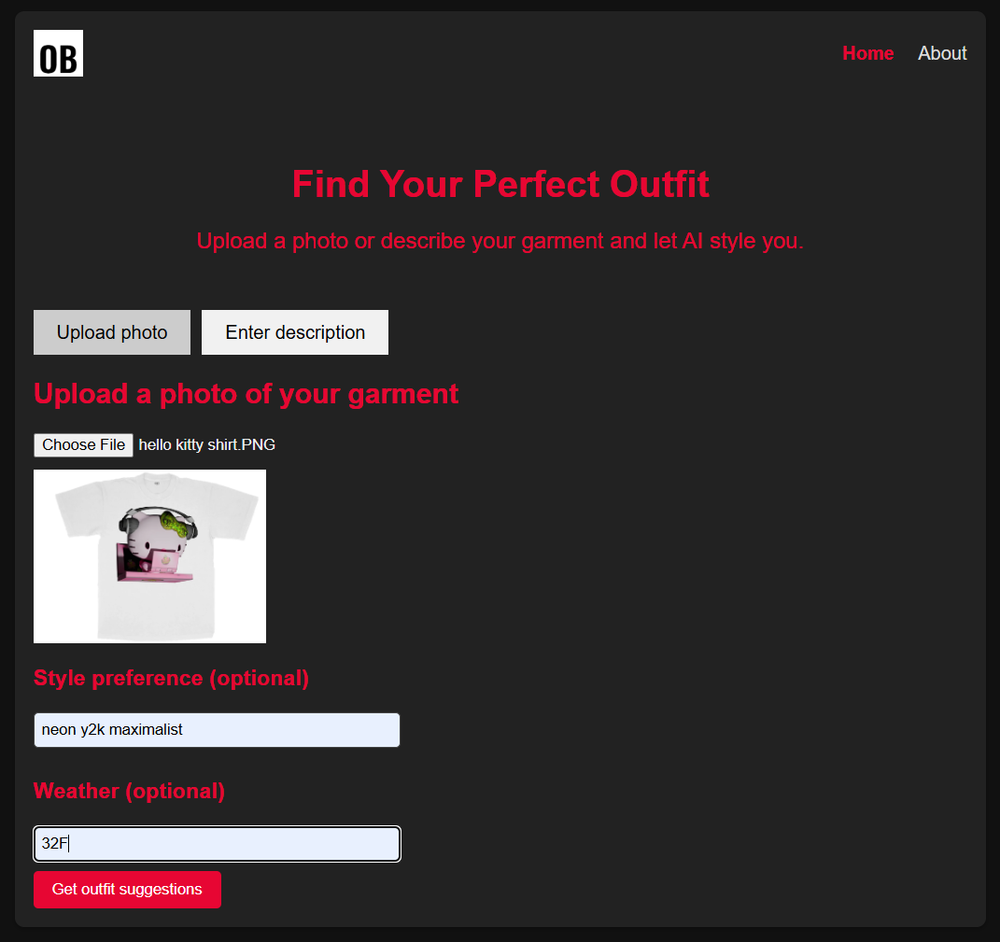
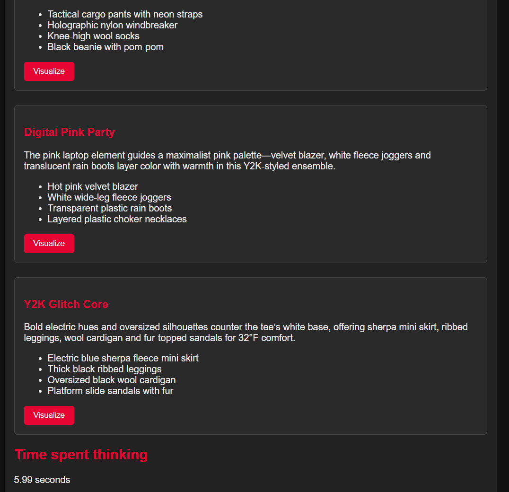

# Outfit Buildr

**AI‑powered outfit recommendation. Vision LLM + CLIP image analysis.**

---

## Table of Contents
- [Overview](#overview)
- [Features](#features)
- [Architecture & Flow](#architecture--flow)
- [Prerequisites](#prerequisites)
- [Quick Start (local)](#quick-start-local)
- [Configuration (environment variables)](#configuration-environment-variables)
- [Docker](#docker)
- [Google Cloud Run Deployment](#google-cloud-run-deployment)
- [Screenshots](#screenshots)
- [Future Work](#future-work)
- [License](#license)

---

## Overview
Outfit Buildr is a lightweight Flask web application that helps users discover outfit suggestions for a garment they **describe** or **upload a photo of**. It leverages:
- **CLIP (ViT‑B‑32)** for fast similarity search over a pre‑computed dataset of 2 000 fashion images.
- **Vision‑LLM** (local Ollama model `qwen3‑vl:2b` or Groq API) to generate structured outfit suggestions.
- **SerpAPI live image search** with CLIP re‑ranking for up‑to‑date piece images, automatically falling back to the cached dataset when the monthly quota is exhausted.
- **Redis‑backed session storage** (max 1 hour) for temporary data such as uploaded images, style preferences, and weather context.

---

## Features
- Two input modes: free‑form description **or** photo upload.
- Pre‑computed CLIP embeddings for instant candidate retrieval.
- Vision‑LLM generation of four structured outfit suggestions (title, reasoning, list of pieces).
- Live SerpAPI image lookup with graceful fallback when the monthly quota is hit.
- Session‑level privacy: uploaded photos are never written to disk.
- Graceful error handling with user‑friendly flash messages.
- Docker‑ready, runs behind Gunicorn with a small memory footprint.

---

## Architecture & Flow
```mermaid
flowchart TD
    A[User visits /] --> B{Select mode}
    B -->|Description| C[POST /generate]
    B -->|Upload photo| D[POST /upload_suggestions]
    C --> E[generate_images() - CLIP cache]
    D --> F[Resize - base64 - Groq vision]
    E --> G[choose_image.html (4 candidates)]
    G --> H[POST /suggestions]
    F --> H
    H --> I{Provider}
    I -->|vision| J[generate_outfit_suggestions()]
    I -->|text_only| K[generate_text_only_suggestions()]
    J & K --> L[Store suggestions in session]
    L --> M[results.html (cards + "Visualize" button)]
    M --> N[POST /visualize]
    N --> O[get_piece_image() – SerpAPI + CLIP re‑rank]
    O --> P[visualize.html (piece images + garment preview)]
```

---

## Prerequisites
- **Python 3.12** (the project was built with 3.12.10).
- **Docker** (optional, for production).
- **Redis** instance reachable via `REDIS_URL`.
- **Ollama** server running locally if you want the built‑in vision model (`qwen3‑vl:2b`).
- **Groq API key** (required for Groq calls).
- **SerpAPI key** (optional; enables live image search).

---

## Quick Start (local)
```bash
# Clone the repo
git clone https://github.com/your‑username/outfit-buildr.git
cd outfit-buildr

# Create a virtual environment & install deps
python -m venv venv
# Windows
call venv\Scripts\activate
# Linux/macOS
source venv/bin/activate
pip install -r requirements.txt

# Create a .env file (or export variables)
cp .env.example .env   # edit the values as needed
export $(cat .env | xargs)

# Run the development server
python app.py   # FLASK_DEBUG=1 gives auto‑reload
```
Open <http://127.0.0.1:5000/> in your browser.

---

## Configuration (environment variables)
| Variable | Description | Example |
|----------|-------------|---------|
| `FLASK_SECRET_KEY` | Secret for signing Flask sessions (required). | `super‑secret‑key` |
| `REDIS_URL` | Redis connection string used for session storage and caching. | `redis://localhost:6379/0` |
| `GROQ_API_KEY` | API key for Groq services. | `gsk_…` |
| `SERPAPI_KEY` | API key for SerpAPI live image search (optional). | `your‑serpapi‑key` |
| `LOG_LEVEL` | Logging verbosity (`DEBUG`, `INFO`, `WARNING`, `ERROR`). | `INFO` |
| `SERPAPI_MONTHLY_CAP` | Maximum SerpAPI calls allowed per month (default 1000). | `1000` |

If a required variable is missing the app will abort with a clear error message.

---

## Docker
A production‑ready Dockerfile is included.
```Dockerfile
# Dockerfile (excerpt)
FROM python:3.12-slim AS builder
# install CPU‑only PyTorch 2.13.0
RUN pip install --no-cache-dir torch==2.13.0+cpu -f https://download.pytorch.org/whl/torch_stable.html
# ... install other deps, copy code, preload CLIP model, etc.
```
### Build the image
```bash
docker build -t outfit-buildr .
```
### Run the container locally
```bash
docker run -d \
  -p 8000:10000 \
  -e FLASK_SECRET_KEY=super-secret-key \
  -e REDIS_URL=redis://host:6379/0 \
  -e GROQ_API_KEY=gsk_… \
  -e SERPAPI_KEY=your-serpapi-key \
  -e LOG_LEVEL=INFO \
  --name outfit-buildr \
  outfit-buildr
```
The container expects `$PORT` (default 10000). Adjust the `-p` mapping as you like.

---

## Google Cloud Run Deployment
1. **Tag & push the image to Google Container Registry (GCR) or Artifact Registry**
   ```bash
   # Authenticate with GCP
   gcloud auth configure-docker
   # Tag (replace PROJECT_ID and REGION as appropriate)
   docker tag outfit-buildr gcr.io/PROJECT_ID/outfit-buildr:latest
   # Push
   docker push gcr.io/PROJECT_ID/outfit-buildr:latest
   ```
2. **Deploy to Cloud Run**
   ```bash
   gcloud run deploy outfit-buildr \
     --image gcr.io/PROJECT_ID/outfit-buildr:latest \
     --platform managed \
     --region us-central1 \
     --allow-unauthenticated \
     --set-env-vars FLASK_SECRET_KEY=super-secret-key,REDIS_URL=redis://HOST:6379/0,GROQ_API_KEY=gsk_…,SERPAPI_KEY=your-serpapi-key,LOG_LEVEL=INFO
   ```
   Cloud Run will automatically allocate a public URL and handle container scaling.

---

## Screenshots
| Home page | Results page |
|---|---|
|  |  |

<!-- Visualize page example (add later) -->
<!--  -->

---

## Future Work
- **Automated testing** – add a pytest suite covering CLIP utilities, Redis quota handling, and Flask view logic.
- CSRF protection with Flask‑WTF.
- Atomic Redis counters for the SerpAPI quota.
- Health‑check endpoint for orchestration platforms.

---

## License
*No license is currently provided.* Add an appropriate open‑source license file (e.g., MIT, Apache‑2.0) when you decide to share the code publicly.
